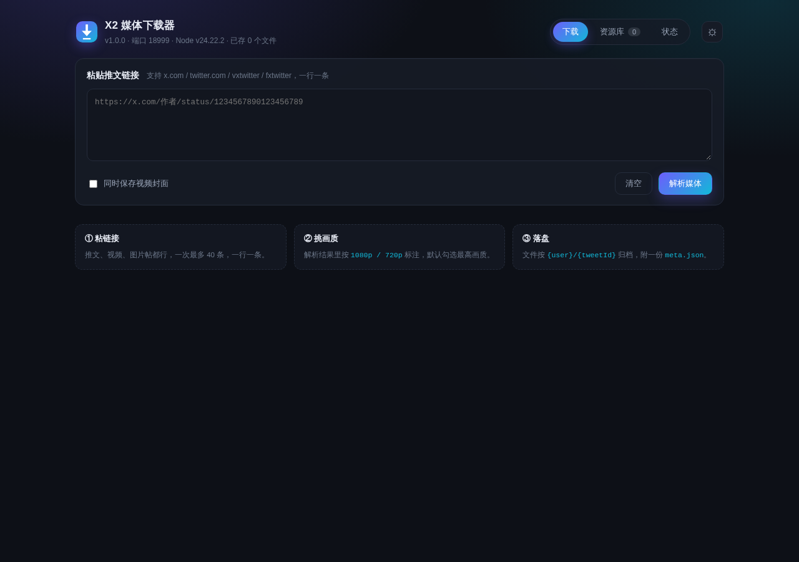
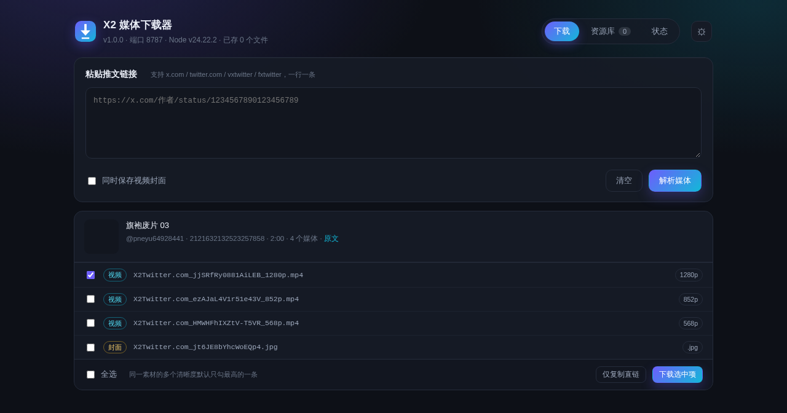

# X2 媒体下载器 · fnOS 应用

把 X（Twitter）推文里的视频和图片直接下到 NAS。

粘一条链接 → 选画质 → 文件按 `作者/推文ID/` 归档，附带一份 `meta.json`。
逻辑移植自 [`x2twitter-eagle-plugin`](../x2twitter-eagle-plugin)（Eagle 插件版），这里换成了 fnOS 上的常驻 Web 服务，不再依赖 Eagle。



解析后默认只勾最高画质那条：



## 功能

- **批量解析**：一次最多 40 条链接，支持 `x.com` / `twitter.com` / `mobile.twitter.com` / `vxtwitter` / `fxtwitter` / `fixupx`，也能直接粘纯推文 ID。
- **按画质挑**：解析结果按 `1080p / 720p / …` 排序并标好类型（视频 / 图片 / 封面）。**默认只勾最高画质那一条**（同一素材的 1080p/852p/568p 是不同清晰度，全勾等于重复下载）；纯图片推文没有画质之分，图片全勾；封面默认不勾。想一次全勾就点条目里的「全选」，或把设置里的「只勾最高画质」关掉。
- **四线路回退**：CDN 直连 → CDN 走代理 → Cloudflare 回源网关 → 网关走代理，任一成功即入库，失败会在任务卡里写清每条线路的原因。
- **多任务并发**：进程内队列，并发数可调（1–6），前端轮询进度条，支持实时显示已下载字节。
- **资源库带缩略图**：视频落盘时顺手抓推文封面存成 `<文件名>.poster.jpg`；抓不到就本地抽帧（有 ffmpeg 时）；老记录第一次打开时回查一次推文封面并缓存。缩略图点开就是播放（视频支持 Range 拖动），可单独删除记录或连文件一起删。
- **离线可用**：不连外网时也能浏览已下载内容、改设置、看日志。
- **不污染系统**：优先用 NAS 自带的 Node；没有就在安装时从 npmmirror 拉一份便携版 Node 22 到应用私有目录，卸载时清掉。

## 安装

```bash
./build.sh              # 产出 x2media.fpk
```

在 fnOS「应用中心 → 手动安装」选这个 `.fpk`。安装向导里可以指定下载目录（留空则用应用私有目录，之后在应用内改）。

打包细节与结构校验见 [`docs/install.md`](docs/install.md)。

## 进度看得见

- 每条推文一根总进度条，按**字节**算（不是按文件个数），单文件下载到 92% 就是 92%，不会停在 0%。
- 进度条下面是 `已下载 / 总大小 · 速度 · 还剩多久`，速度用两次轮询的增量算并做平滑。
- 每个文件自己还有一根细进度条；服务器没给 `Content-Length` 时显示流光，表示「在动但算不出百分比」。
- 全部文件落盘后还有封面 / 预览图要抓，这段时间显示「收尾中（封面 / 预览图）」，不会假装已经完成。
- 完成的任务显示 `完成 N/N` 与总用时，8 秒后自动收起。

## 用起来

1. 打开桌面的「X2 媒体下载器」入口（端口 8787）。
2. 粘链接，点「解析媒体」。
3. 勾选想要的条目，点「下载选中项」。
4. 「资源库」里预览或删除。

文件默认落在：

```
${TRIM_PKGVAR}/downloads/<作者>/<推文ID>/X2Twitter.com_1280p.mp4
${TRIM_PKGVAR}/downloads/<作者>/<推文ID>/meta.json
```

想让文件出现在共享文件夹里（例如 SMB 里能直接看），把「设置 → 下载目录」改成 `/vol1/1000/media/x2media` 这类绝对路径即可，目录模板支持 `{user}` `{tweetId}` `{date}` `{id}`。

## 需要代理时

「设置 → HTTP 代理」填 `http://192.168.1.2:7890`。留空则读服务进程的 `HTTPS_PROXY` / `HTTP_PROXY` 环境变量。只支持 HTTP 代理（CONNECT 隧道），不支持 SOCKS。

## 开发

```bash
node app/server/server.js            # 本地起服务（默认 8787，变量见下）
node --test tests/parse.test.mjs     # 解析逻辑单测
node --test tests/smoke.test.mjs     # 端到端：起进程 → 真下载 → 入库 → Range 读取
./build.sh                           # 结构 + 语法检查 + 打包
```

服务端环境变量：

| 变量 | 作用 | 默认 |
| --- | --- | --- |
| `X2_PORT` | 监听端口 | `8787` |
| `X2_BIND` | 绑定地址 | `0.0.0.0` |
| `X2_VAR` | 可写目录（设置、索引、日志、默认下载） | `~/.x2media` |
| `X2_APPDEST` | 安装目录（只读代码） | 仓库根 |
| `X2_VERSION` | 版本号（写进 `/api/state`） | `1.0.3` |
| `X2_ACCESS_LOG` | 设为 `1` 打印访问日志 | 关 |

目录结构：

```
manifest                 fnOS 清单（appname/端口/桌面入口）
ICON.PNG ICON_256.PNG    应用中心与桌面图标
app/
  server/                常驻服务（Node，无第三方依赖）
    server.js            路由 + 任务队列
    lib/x2.js            x2twitter 两条接口 + 结果解析
    lib/net.js           HTTP(S)、代理隧道、流式下载
    lib/downloader.js    四线路下载、原子落盘、封面
    lib/store.js         设置、资源库索引、路径与命名
    public/              前端（原生 JS/CSS，无构建步骤）
  ui/
    config               桌面入口定义（x2media.Application）
    images/              icon_64.png / icon_256.png
cmd/                     fnOS 生命周期脚本（main 负责 start/stop/status）
config/                  privilege（run-as: package）、resource（data-share）
wizard/                  安装 / 升级 / 配置 / 卸载向导字段
scripts/make-icons.mjs   纯 Node 生成图标 PNG
tests/                   单测 + 冒烟
```

API 与数据流见 [`docs/architecture.md`](docs/architecture.md)。

## 常见问题

**解析报「解析接口被 Cloudflare 拦截」**
x2twitter 前面挂着 CF，机房 IP 或高频请求会触发挑战。换出口 IP（配代理）、隔几秒重试；连续解析多条时排队请求本身已经做了重试。

**解析报「x2twitter 接口限流（Cloudflare 1015）」/ 按钮变成「限流 30s」**
x2twitter 的 `/api/userverify` 按 IP 限得很死，触发后 Cloudflare 会返回 `error code: 1015` 并带 `Retry-After`（常见 30 分钟）。**1.0.2 起默认不再调用它**：实测 `/api/ajaxSearch` 不校验令牌（`cftoken` 传空串照样返回结果），所以解析直接走匿名搜索，一条请求搞定，令牌只在搜索接口真的要求时才去拿。万一还是撞到限流，应用会：
- 把 429/1015 翻译成「限流 + 剩余秒数」，不再报「令牌响应不是 JSON」；
- 进入冷却期后**完全不发请求**，按钮显示倒计时，到点自动恢复；
- 同一链接 10 分钟内走缓存，重复点解析不打扰接口；
- 两次解析之间强制 ≥4 秒间隔。
冷却期间换出口 IP 立刻恢复：设置里填 HTTP 代理（如 `http://192.168.1.10:7890`）保存即可。批量解析时请分几次贴，别一次几十条。

**装完启动不起来，日志里没有 Node**
看 `${TRIM_PKGVAR}/info.log`。便携 Node 没下成功时，可手动把任意 Node ≥18 放到 `${TRIM_PKGVAR}/runtime/node/bin/node`，或用系统 Node（`command -v node`）后重启应用。

**下载目录改成共享文件夹后报「无权限」**
`run-as: package` 意味着应用以非 root 身份跑。共享目录要给 `package` 用户写权限，或者改回应用私有目录。

**视频在资源库里没有缩略图**
默认不存封面。勾「同时保存视频封面」或在设置里打开，下载时会顺手抓一张 `cover.jpg`。

**桌面图标下面显示的是 `{display_name}` 这串字符**
`fnpack create` 生成的 `app/ui/config` 模板里写着 `"title": "{display_name}"`，但 fnOS 装包时只替换图标里的 `{0}`（分辨率），不替换命名字段。`title` 必须是字面量：本包已直接写死「X2 媒体下载器」。自己改了 manifest 的 `display_name` 之后，记得同步改 `app/ui/config` 的 `title`，两者都改完再 `./build.sh` 覆盖安装，桌面入口才会刷新。

## 许可

服务端代码与前端为本项目原创；x2twitter 接口调用逻辑改编自 `x2twitter-eagle-plugin`（MIT）。
